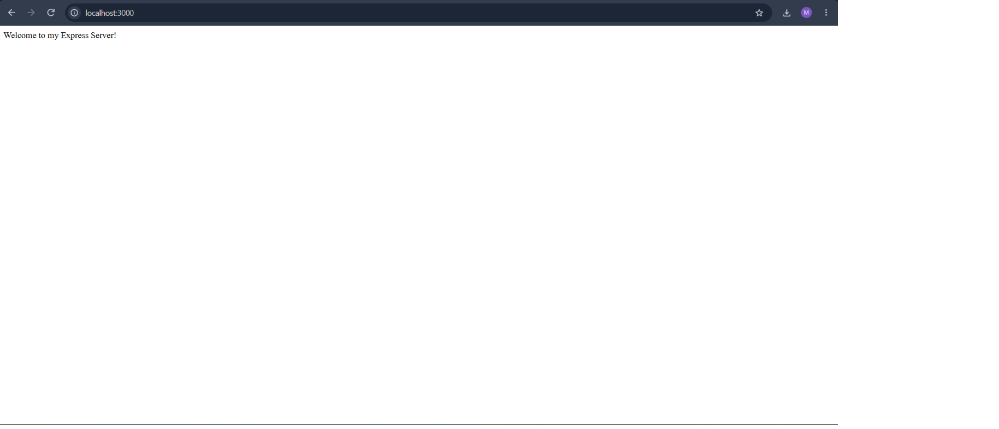
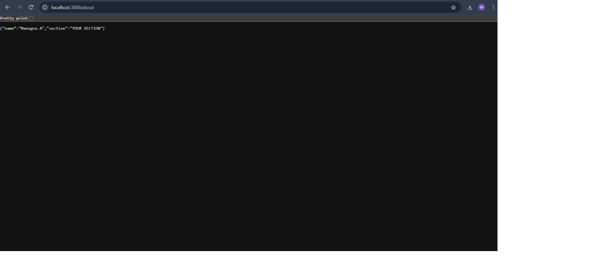
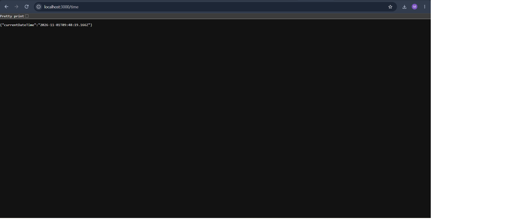
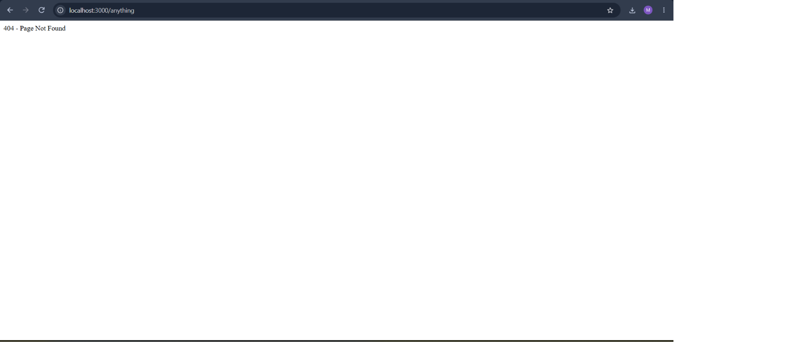

# Lab 1: Node.js and Express Server

## Student Details

- **Name:** Manogna.A
- **Registration Number:** 252U1R8051
- **Section:** S-13 Quantum Engineering 1B


## Live Deployment Link

**Deployment URL:** https://manogna-lab01.onrender.com


The public deployment URL will be added after deploying the application.

## Project Description

This project demonstrates the creation of a web server using Node.js and Express.js. It includes a basic HTTP server using Node.js built-in HTTP module and an Express server with different GET routes.

The application handles HTTP requests, sends appropriate responses, displays JSON data, retrieves the current date and time, and returns a 404 error message for unknown routes.

## Technologies Used

- Node.js
- Express.js
- JavaScript
- Visual Studio Code

## Installation Steps

1. Install Node.js and npm.
2. Clone the GitHub repository.
3. Navigate to the lab-01 directory.
4. Install the required dependencies using:

```bash
npm install
```

## Execution Steps

Run the following command in the terminal:

```bash
node server.js
```

The server will start on port 3000.

Open the following URL in your browser:

```text
http://localhost:3000
```

## Environment Variables

No environment variables are required for local execution.

## API Endpoints

| HTTP Method | Endpoint | Description | Status Code |
|---|---|---|---|
| GET | `/` | Displays the welcome message. | 200 OK |
| GET | `/about` | Returns student name and section in JSON format. | 200 OK |
| GET | `/time` | Returns the current date and time. | 200 OK |
| GET | Unknown route | Returns a page not found message. | 404 Not Found |

## Screenshots

### 1. Home Endpoint



### 2. About Endpoint



### 3. Time Endpoint



### 4. 404 Error Handling




## Notes

- Node.js built-in HTTP module was used to create a basic HTTP server.
- Express.js was used to create the web server and handle routes.
- All required GET endpoints were tested using a web browser.
- Appropriate HTTP status codes were returned for successful and unknown routes.
- The `node_modules` folder and `.env` files are excluded from GitHub using `.gitignore`.
- No environment variables are required for local execution.