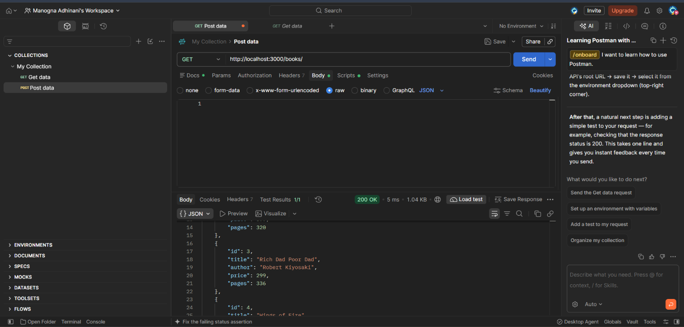
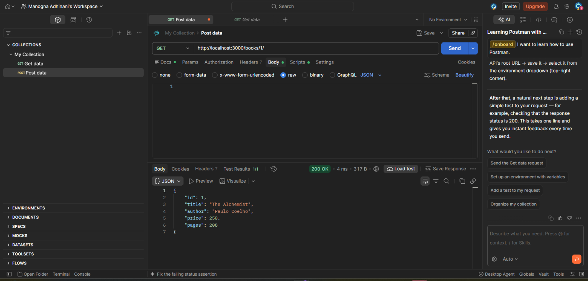
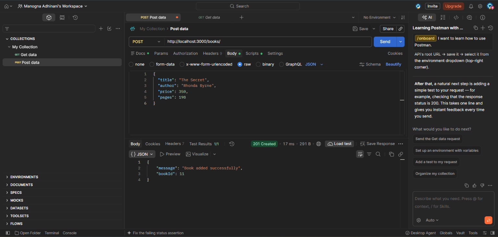
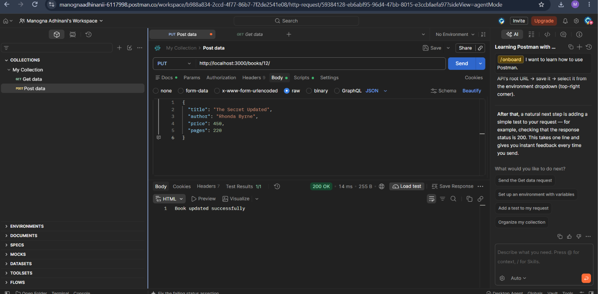
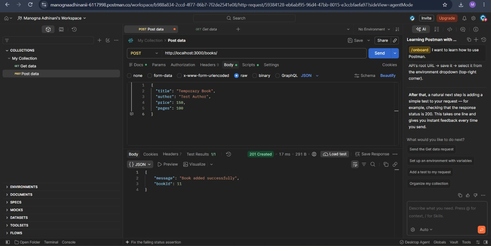
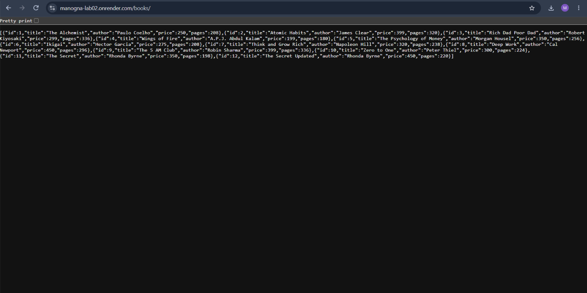

# Lab 2: SQLite Database and CRUD Routes


**Live Deployment:** https://manogna-lab02.onrender.com
## Student Details

- **Name:** Manogna.A
- **Registration Number:** 252U1R8051
- **Section:** S-13 Quantum Engineering 1B
- **Lab Number:** 02

## Objective

To connect an Express server with an SQLite database and perform CRUD operations through HTTP routes.

## Technologies Used

- Node.js
- Express.js
- SQLite
- SQLite3
- Postman
- Nodemon

## Installation and Setup

1. Install the dependencies:

   ```bash
   npm install
   ```

2. Start the server:

   ```bash
   npm start
   ```

3. The server runs at:

   `http://localhost:3000/`

## Database Structure

**Database:** books.db

**Table:** book

| Column | Data Type |
|---|---|
| id | INTEGER PRIMARY KEY |
| title | TEXT |
| author | TEXT |
| price | INTEGER |
| pages | INTEGER |

The database contains 10 initial book records.

## API Endpoints

| HTTP Method | Endpoint | Description |
|---|---|---|
| GET | `/books/` | Retrieve all books |
| GET | `/books/:bookId/` | Retrieve a specific book |
| POST | `/books/` | Add a new book |
| PUT | `/books/:bookId/` | Update a book |
| DELETE | `/books/:bookId/` | Delete a book |

## Parameterized Queries

SQL queries use `?` placeholders to safely handle user input and help prevent SQL injection.

## Screenshots

### 1. GET All Books



### 2. GET Book by ID



### 3. POST New Book



### 4. PUT Update Book



### 5. DELETE Book



### 6. Live API Deployment



## Environment Variables

- `PORT`: Server port. Defaults to 3000.

## Conclusion

Successfully connected an Express server to an SQLite database and implemented all five CRUD operations. Tested the API endpoints using Postman and verified database operations.
